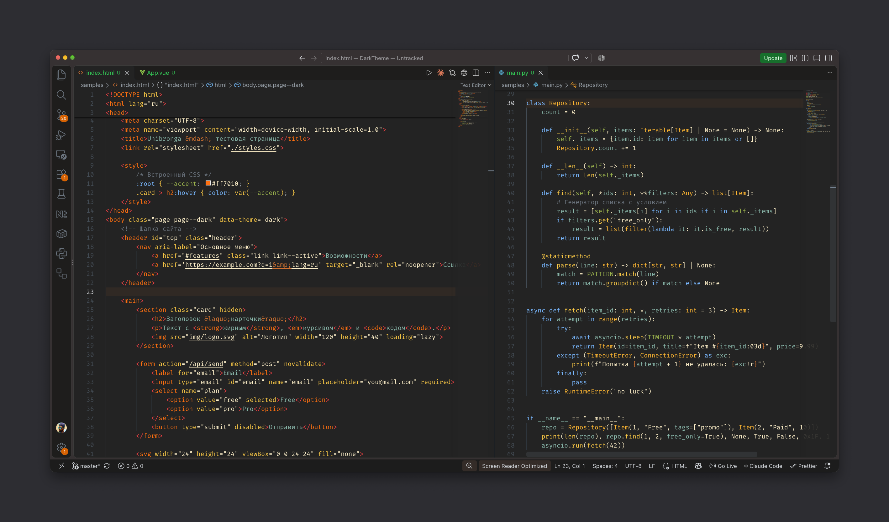

# Unibronga One Dark

A dark theme for VS Code with amber, yellow, teal and blue accents.



## Languages

Hand-tuned highlighting for JavaScript, TypeScript, HTML, CSS/SCSS, JSON, Vue, Python, PHP and Markdown.
Semantic highlighting from Pylance and Vue (Official) is supported.

## Recommended settings

Add to your `settings.json`:

```json
{
    "workbench.colorTheme": "Unibronga One Dark",
    "editor.fontFamily": "'Fira Code', Inconsolata, Consolas, 'DejaVu Sans Mono', Menlo, monospace",
    "editor.fontSize": 14,
    "editor.lineHeight": 20,
    "editor.fontLigatures": false,
    "editor.bracketPairColorization.enabled": false
}
```

Turning off bracket pair colorization keeps brackets in the theme's own colors instead of VS Code's rainbow pairs.

## Install

Install from the [VS Code Marketplace](https://marketplace.visualstudio.com/items?itemName=Unibronga.unibronga-one-dark-theme),
or press `Cmd+P` / `Ctrl+P` and run `ext install Unibronga.unibronga-one-dark-theme`.
